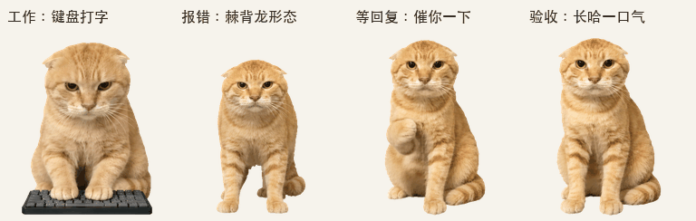

# 耄耋 · Maodie Pet 😾

一只会敲键盘、催回复、报错炸毛、验收哈气的真实照片风格宠物。基于「耄耋」梗制作，适用于支持 Pets 的 ChatGPT Work 环境。

**[下载完整 v2 精灵图](assets/maodie-spritesheet.png)** · **[下载网页上传兼容版 v1](assets/maodie-spritesheet-web-v1.png)** · **[下载发布包](https://github.com/Jerryhhhhhh/maodie-pet/releases/latest)**



## 怎么使用

### 共享链接：需要接收方具备相应功能和权限

2026-10-25 收到跨账号打开共享链接时提示「你没有权限访问此对话。可能需要切换账号」的反馈。**共享链接不能保证对所有账号可用，也不能作为通用下载入口。** 此前只确认了链接创建成功和 GitHub 公开下载，没有完成另一账号的领养测试。

如果你的账号已启用 Pets，可以在支持该插件的对话中尝试：

```text
请领养并选用这个宠物：
https://chatgpt.com/s/sharepet_6ad9c35332288191add36239fb5688ce
```

领养成功后会在你的宠物库中创建副本。若出现权限提示，目前无法仅凭这句话确定是接收方功能可用性、工作区共享范围，还是链接路由问题。该提示也不能证明你一定登录了错误账号。

### 手动导入：有「Upload pet」入口时使用

1. 下载 [网页上传兼容版 v1 PNG](assets/maodie-spritesheet-web-v1.png)。
2. 在 ChatGPT 网页设置中，进入 **Personalization → Pet → Select pet**，找到 **Upload pet** 后上传该文件。
3. 按界面提示选用新宠物。

截至 2026-10-25，[官方 Pets 文档](https://learn.chatgpt.com/docs/pets) 将网页手动上传格式列为透明 PNG/WebP、**1536 × 1872**、不超过 20 MiB，并说明 Pets 的可用性取决于账号和工作区。如果设置里没有这个入口，下载文件不会自动解锁该功能。

兼容版保留全部九组基础动画，共 57 帧，像素与完整版本的前九行一致；它不包含额外的 16 个注视方向。对于支持 v2 的 Pets 工具，继续使用 [完整 v2 PNG](assets/maodie-spritesheet.png)。

## 它会做什么

| 状态 | 动作 |
| --- | --- |
| 待机 | 呼吸、眨眼、小幅抬头 |
| 左右移动 | 自然猫步，分别面向左右 |
| 招呼 | 抬起一只前爪 |
| 跳跃 | 蓄力、腾空、落地 |
| 报错 | 弓背炸毛，进入「棘背龙形态」 |
| 等回复 | 同一只前爪弯回胸前，再向前伸出，连续催两次 |
| 工作 | 两只猫爪交替敲键盘 |
| 成果检查 | 连续四帧张嘴哈气，标准节奏约 **0.73 秒** |
| 看向光标 | 16 个顺时针注视方向 |

哈气是 `review` 状态中的视觉动作。当前 Pets 工具不提供自定义音效或可配置的“每次会话结束”触发器。

## 预览与备用动作

- [全部九组动画](previews/all-states.gif) / [MP4](previews/all-states.mp4)
- [16 方向环视](previews/look-loop.gif)
- [全部帧总览](previews/contact-sheet.png)
- [挠头、托腮备用动画](variants/thinking.gif) / [透明六格图](variants/thinking-strip.png)

备用动画包含 4 帧挠头和 2 帧托腮，最后两帧保持同一只爪。**主版工作动作是打字**，备用动作不会随机穿插；使用备用版需要替换工作动画行并重新验证完整精灵图。

## 文件规格

| 项目 | 值 |
| --- | --- |
| 格式 | 透明 PNG，v2（主版） |
| 图集尺寸 | 1536 × 2288 |
| 网格 | 8 列 × 11 行 |
| 单格尺寸 | 192 × 208 |
| 有效帧 | 73 |
| 每行帧数 | 6, 8, 8, 4, 5, 8, 6, 6, 6, 8, 8 |

SHA-256：

```text
a6b924845704ff812247841a43b3aff2655297af93dad1198848c9355a9d3932
```

网页上传兼容版 v1 为 **1536 × 1872、8 列 × 9 行、57 帧**；不改变前九行的任何动画像素。

帧顺序、播放时长、导出格式与方向定义见 [pet.json](pet.json)，验证摘要见 [validation.json](validation.json)。主版图集通过了本地结构、动作、方向检查和 Pets 上传前验证；这些检查不等于接收方账号的领养权限验证。

## 制作与来源

以真实耄耋照片为视觉基准，用内置 ImageGen 制作和编辑动作，再完成背景清理、拼接及逐帧检查。打字版的脸型和浅沙金毛色已与基准对齐。

感谢 [yr-96/meme-library](https://github.com/yr-96/meme-library/tree/4aac9fcefcb753e17cc046fb8da1da7a6581bd6b/examples/sample_lib/maodie_cats) 的表情素材归档。其他参考出处见 [CREDITS.md](CREDITS.md)。

## English

A photo-based Maodie meme cat for ChatGPT Work Pets: keyboard typing, impatient paw taps, a bristling error reaction, and a long hiss during review. Includes nine animation states and sixteen look directions.

The **[shared adoption link](https://chatgpt.com/s/sharepet_6ad9c35332288191add36239fb5688ce)** requires a recipient account/workspace with compatible Pets access. Cross-account permission errors have been reported; successful link creation does not prove that every recipient can adopt it.

If your web settings offer **Upload pet**, use the [v1 web-upload PNG](assets/maodie-spritesheet-web-v1.png), matching the 1536 × 1872 format currently documented by [OpenAI](https://learn.chatgpt.com/docs/pets). It preserves all nine standard animations (57 frames), but omits the sixteen look-direction frames. Use the [full v2 PNG](assets/maodie-spritesheet.png) with tools that support it. A missing Pets feature cannot be unlocked by downloading the file.

The thinking animation is an optional alternative to typing. Custom audio and configurable session-end triggers are not provided by the current Pets tools.
